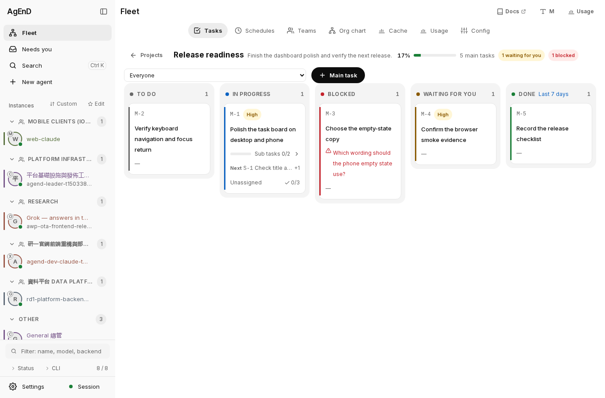
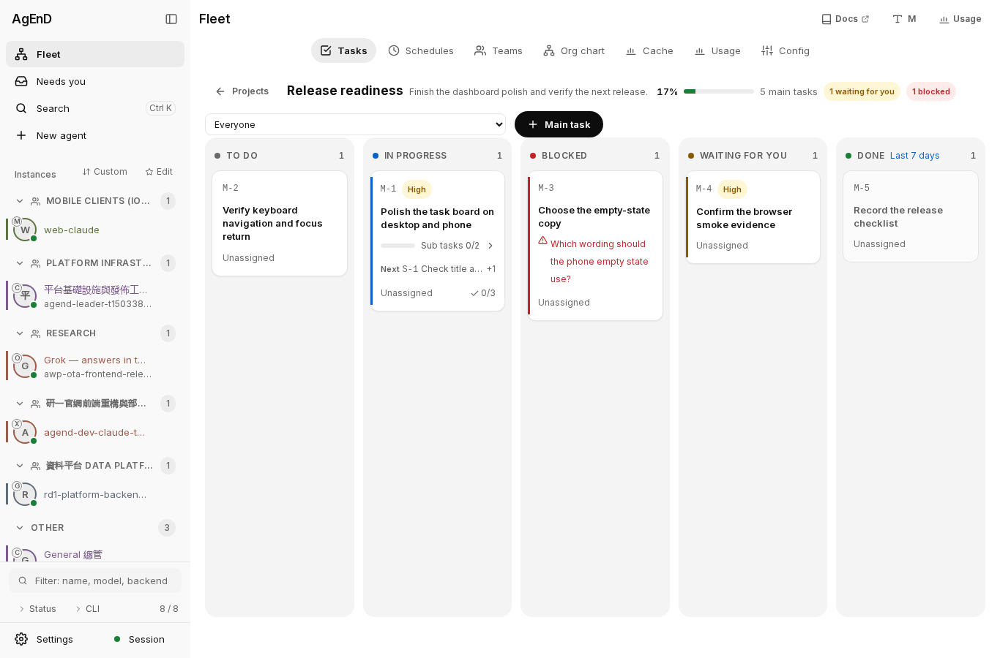
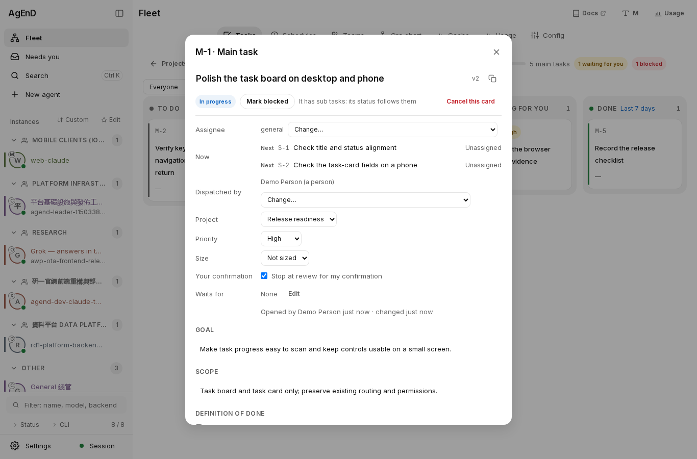
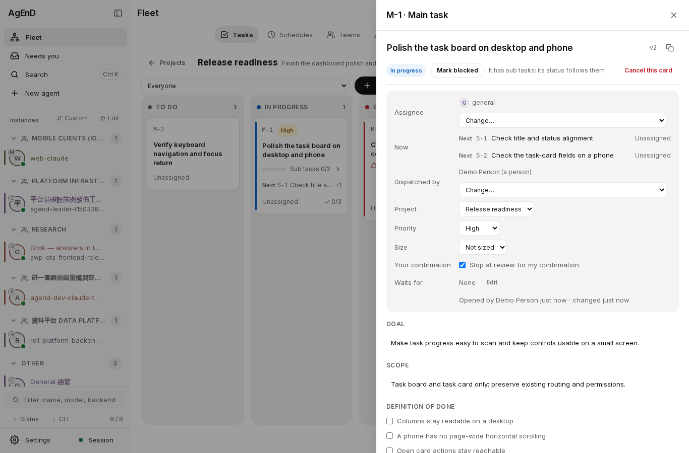
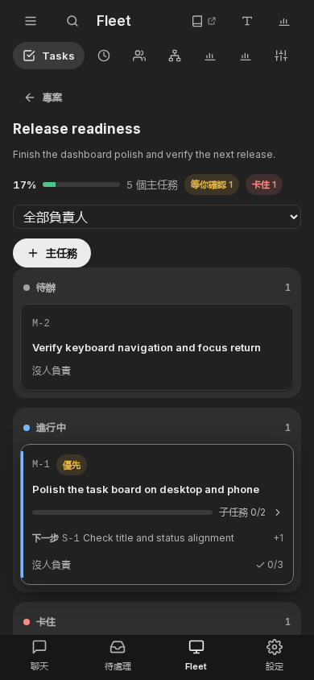
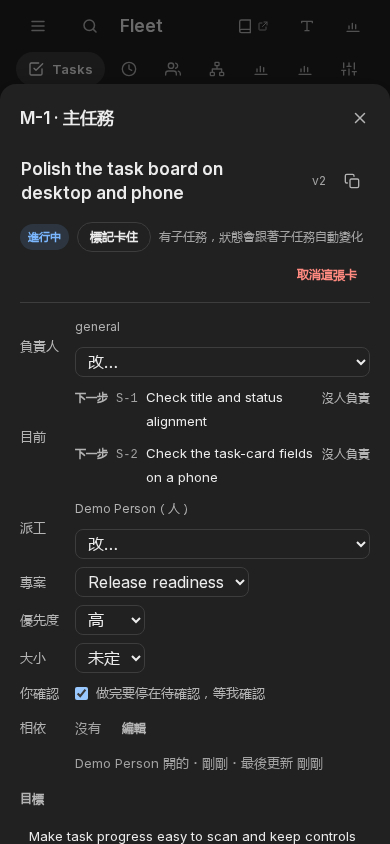

# PR #2313 refreshed visual comparison

Design decision pending; these images are review evidence, not merge approval.

- Baseline: main `2b8de2d865118b6b5be37fd651b64e5b3b5d94e3`.
- Candidate: PR #2313 `cc0153d16959f446b0e2c8d31128c358295ad9ef`.
- Same synthetic board and open card; five task states and two subtasks.
- Desktop: 1366 × 900, light theme, English. Phone: 390 × 844, dark theme, Traditional Chinese.
- Chromium, isolated scratch web fixture; no live fleet was started.
- Shared left bar: 3 px wide, 8 px top/bottom inset, 0 px radius on both layouts. Active task states keep the bar; the candidate intentionally hides it for open/done.
- Both snapshots: no page-wide horizontal overflow, off-screen dialog buttons, page errors, or CSP violations in these cases.

## Desktop board

Before:

After:

## Desktop open card

Before:

After:

## Phone board

Before:

After:

## Phone open card

Before:

After:

